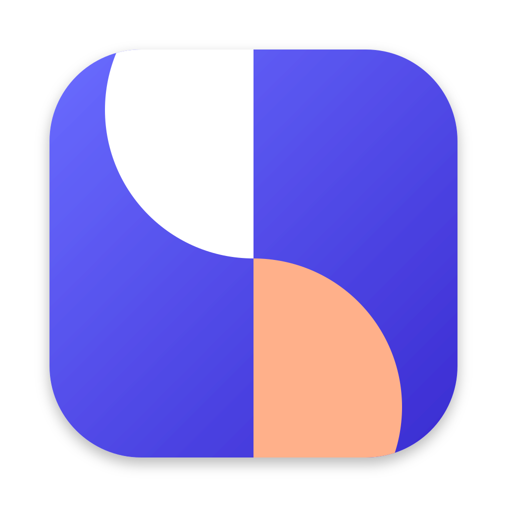
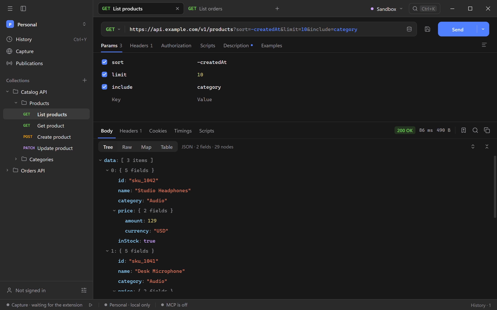

<div align="center">
  <a href="https://schemo.app">
    
  </a>

  <h1>Schemo</h1>

  <p>
    Open-source desktop API client for building, testing, and sharing requests.
  </p>

  <p>
    <strong>HTTP · GraphQL · gRPC · WebSocket · SSE</strong>
  </p>

  <p>
    <a href="https://github.com/schemo-app/schemo/releases">Download</a> ·
    <a href="#features">Features</a> ·
    <a href="#development">Development</a>
  </p>

<picture>
  <source media="(prefers-color-scheme: dark)" srcset="./docs/media/schemo-light.png">
  
</picture>

</div>

## Features

- **API protocols** - HTTP, GraphQL, gRPC (unary and server streaming), WebSocket, and SSE. Explore GraphQL schemas and load gRPC definitions via reflection or `.proto` files.
- **Response inspector** - View JSON as a tree, map, or table. Navigate JSON:API relationships, export CSV, preview media, inspect Hex, and save response files.
- **Collections** - Organize requests into folders, manage environments, inherit variables and authorization, and save response examples.
- **Testing** - Run collections with pre-request scripts and response assertions.
- **Authentication** - Bearer, Basic, API Key, JWT, AWS SigV4, Digest, and OAuth 2.0.
- **History** - Search and replay requests, inspect headers, cookies, and timings. Capture browser traffic with [Schemo Bridge](https://github.com/schemo-app/extension).
- **Import & export** - Import from Postman, Insomnia, OpenAPI, HAR, or cURL. Export collections or copy requests as cURL, Fetch, wget, HTTPie, or PowerShell.
- **Collaboration** - Sync team workspaces, manage roles, and publish collection documentation with Schemo Cloud.
- **MCP** - Let AI agents discover, execute, and inspect saved requests through the built-in MCP server. [Learn more](docs/MCP.md).

## Installation

Download the latest release from [GitHub Releases](https://github.com/schemo-app/schemo/releases).

| Platform | Package          | Requirements          |
|----------|------------------|-----------------------|
| macOS    | Universal `.dmg` | macOS 12+             |
| Windows  | x64 installer    | Windows 10+, WebView2 |
| Linux    | amd64 `.deb`     | GTK 3, WebKitGTK 4.1  |

Schemo works locally without an account. Workspace data is stored in SQLite under `~/.schemo`, and refresh tokens are kept in the OS credential store. Updates are verified before installation.

See [Data & Security](docs/DATA.md) for details.

## Development

Schemo is built with Go, Wails, and Vue.

Install Go and Node.js versions specified in [go.mod](go.mod) and [.node-version](.node-version), plus [Task](https://taskfile.dev/) and the required Wails platform dependencies.

```sh
task dev      # Start development
task test     # Run tests
task build    # Build application
```

## Documentation

- [Architecture](docs/ARCHITECTURE.md)
- [Data & Security](docs/DATA.md)
- [MCP](docs/MCP.md)
- [Translations](docs/TRANSLATIONS.md)
- [Releases](docs/RELEASE.md)

## License

[MIT](LICENSE.md)
