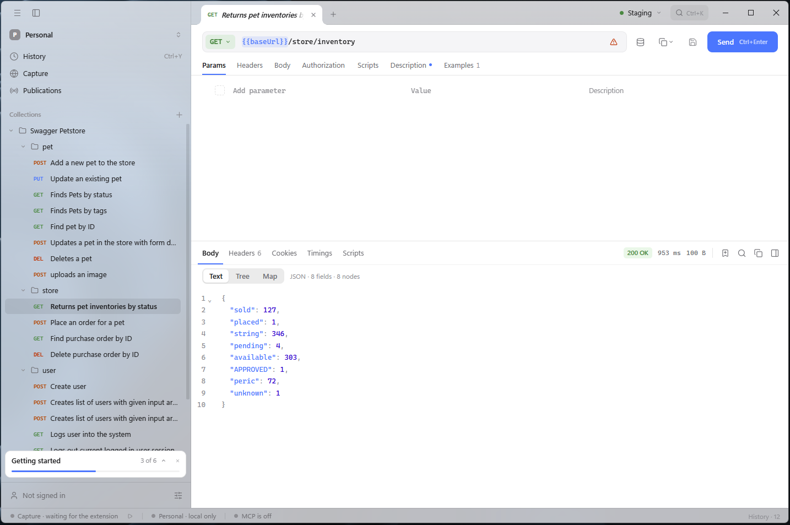

# Schemo

A cross-platform API client for building, testing, and sharing HTTP requests.

Features include collections, environments, scripts, searchable history, JSON:API navigation and [browser request capture](https://github.com/schemo-app/extension).

Requests can be exported as cURL, fetch, wget, HTTPie or PowerShell.

<picture>
  <source media="(prefers-color-scheme: dark)" srcset="docs/media/screenshot-dark.png">
  
</picture>

## Install

Download from [GitHub Releases](https://github.com/schemo-app/schemo/releases):

- macOS 12+ — `.dmg`
- Windows 10+ — installer
- Linux — `.deb`

Linux requires GTK4 and WebKitGTK 6.0.

Application updates are cryptographically verified.

## Data and Security

- Local SQLite is not encrypted.
- Refresh tokens use the operating system credential store; access tokens stay in memory.
- Cloud content is encrypted at rest. The server can decrypt it, so this is not end-to-end encryption.
- Account and cloud connections require verified HTTPS, except explicit loopback development addresses.

Local database:

| Platform | Path |
|---|---|
| macOS | `~/Library/Application Support/schemo/app.db` |
| Windows | `%APPDATA%\schemo\app.db` |
| Linux | `${XDG_CONFIG_HOME:-~/.config}/schemo/app.db` |

See [Data Protection](docs/ENCRYPTION.md) for details.

## Development

Use Go from [go.mod](go.mod), Node.js from [.node-version](.node-version), and [Task](https://taskfile.dev/).

Native builds also require the platform dependencies used by Wails.

```sh
task dev       # development with hot reload
task build     # build the application
task test      # run checks and tests
task package   # build the native package
```

After changing Wails-bound Go methods:

```sh
task generate:bindings
```

Use `task --list` for other commands.

## Documentation

- [Translations](docs/TRANSLATIONS.md)
- [Architecture](docs/ARCHITECTURE.md)
- [Design](docs/DESIGN.md)
- [Frontend](docs/FRONTEND.md)
- [Sync](docs/SYNC.md)
- [MCP](docs/MCP.md)
- [Releases](docs/RELEASE.md)

## License

[MIT](LICENSE.md)
