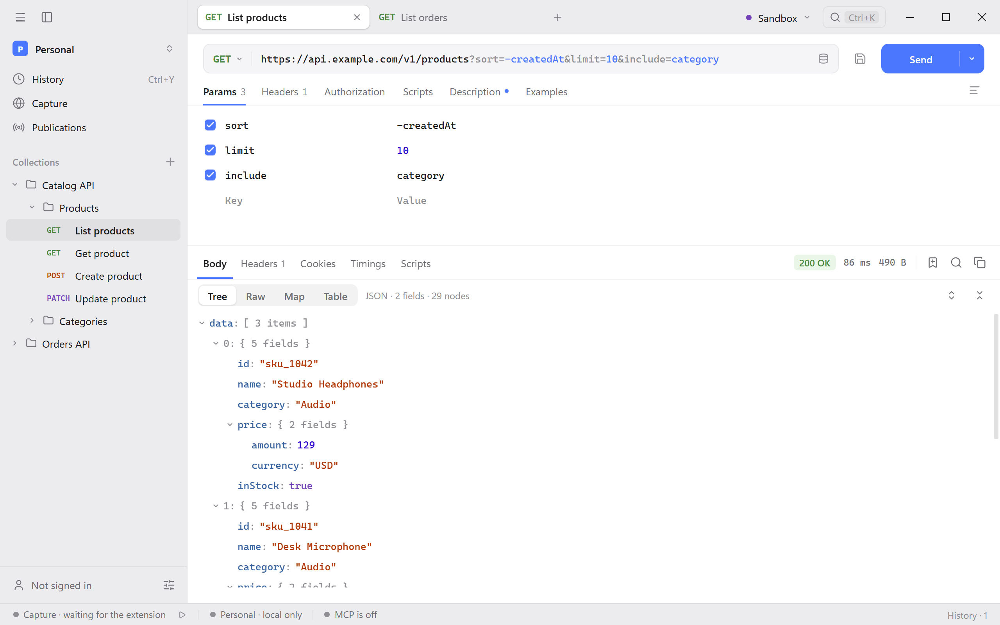

<div align="center">
  <a href="https://schemo.app">
    
  </a>

  <h3>Schemo</h3>

  <p>
  <strong>Open-source desktop API client for testing and debugging APIs</strong>
  </p>

  <p>
    <a href="https://github.com/schemo-app/schemo/releases"></a>
    <a href="https://github.com/schemo-app/schemo/actions/workflows/ci.yml"></a>
    <a href="./LICENSE.md"></a>
  </p>

  <p>
    <sub>
      <a href="#features">Features</a> ·
      <a href="#installation">Installation</a> ·
      <a href="#documentation">Documentation</a>
    </sub>
  </p>

  <p>
    <a href="https://schemo.app">
      <picture>
        <source media="(prefers-color-scheme: dark)" srcset="./docs/media/schemo-dark.png">
        <source media="(prefers-color-scheme: light)" srcset="./docs/media/schemo-light.png">
        
      </picture>
    </a>
  </p>
</div>

### Features

**Request.** Build an HTTP request from a method and URL, or paste a cURL command into the address field.

- Edit query parameters and headers as a table or as text.
- Send JSON, XML, form data, raw text, or a file.
- Copy a request as cURL, Fetch, wget, HTTPie, or PowerShell.

**GraphQL.** Inspect the schema while writing a query or mutation.

- Load the schema from the endpoint or local files.
- Browse types and operations and insert a query from the schema.
- Supply variables and choose the operation to run.

**gRPC.** Browse services and call unary or server-streaming methods. Load definitions through server
reflection or from local `.proto` files.

**WebSocket.** Connect to an endpoint, send messages, and inspect both sides of the conversation.

**Server-Sent Events.** Watch incoming events as they arrive and inspect their names, IDs, and data.

**Authorization.** Use Basic, Bearer, API keys, JWT, AWS SigV4, Digest, or OAuth 2.0. Set authorization
on a collection or folder to reuse it across requests.

**Response.** Inspect the body, headers, cookies, and timing breakdown.

- Search JSON as a tree, explore its structure as a map, or switch to the raw body.
- Sort and filter arrays in a table and export them as CSV.
- Follow relationships in JSON:API responses.
- Preview images and video, inspect the first 256 bytes in Hex, or save the binary file.

**History.** Find a previous request, inspect its response, and replay it from the editor.

**Collections.** Organize requests into nested folders and keep example responses alongside them.
Import from Postman, Insomnia, OpenAPI, or HAR, and export collections to share them as files.

**Environments.** Keep URLs and credentials in named sets of variables. Switch environments to
run the same collection against another API instance, and reuse variables in requests and scripts.

**Scripts and collection runs.** Use JavaScript before a request and assertions after the response.
Run a collection or folder and review the results for each request.

**Workspaces.** Keep collections and history on your device without an account. Connect to Schemo
Cloud to sync shared workspaces and manage access through member roles.

**Published documentation.** Turn a collection into a web page with request and response examples.
Choose public, unlisted, or password-protected access.

**MCP.** Let an agent find saved requests and inspect their responses in selected workspaces.
Sending and editing have separate permissions, and you can require approval for sends.
[MCP setup](docs/MCP.md)

**Theming and shortcuts.** Choose light, dark, or system appearance. Adjust the accent and code
font, and customize keyboard shortcuts.

**Add-ons**

- [Schemo Bridge](https://github.com/schemo-app/extension) captures requests from selected browser tabs
  and sends them to the desktop app for inspection and replay.
- Schemo Cloud provides workspace sync, team access, and
  hosted collection documentation.

## Installation

Get the desktop app from [GitHub Releases](https://github.com/schemo-app/schemo/releases).

- **macOS** · Universal `.dmg` for macOS 12 or later.
- **Windows** · x64 installer for Windows 10 or later with WebView2.
- **Linux** · amd64 `.deb` for systems with GTK 3 and WebKitGTK 4.1.

## Usage

1. Open a request tab and enter your API endpoint.
2. Choose the method, add any required inputs, and select **Send**.
3. Inspect the response. Save the request to a collection if you want to run it again.

## Developing

Schemo uses Go, Wails, and Vue. Install Go and Node.js using the versions in [go.mod](go.mod)
and [.node-version](.node-version), then install [Task](https://taskfile.dev/) and the Wails
dependencies for your platform.

```sh
task dev
task test
task build
```

## Documentation

[Architecture](docs/ARCHITECTURE.md) · [Data and security](docs/DATA.md) ·
[MCP](docs/MCP.md) · [Translations](docs/TRANSLATIONS.md) · [Release process](docs/RELEASE.md)

## Contributing

Open an [issue](https://github.com/schemo-app/schemo/issues) for a bug or feature request, or open a
[pull request](https://github.com/schemo-app/schemo/pulls) with a fix. For translation changes, see
the [translation guide](docs/TRANSLATIONS.md).

## Continuous Integration

[GitHub Actions](https://github.com/schemo-app/schemo/actions) runs the frontend and Go checks,
verifies generated bindings, and builds release packages.

## Changelog

Release notes and downloads are available on [GitHub Releases](https://github.com/schemo-app/schemo/releases).

## Authors

See the [contributors](https://github.com/schemo-app/schemo/graphs/contributors).

## License

[MIT](LICENSE.md)
