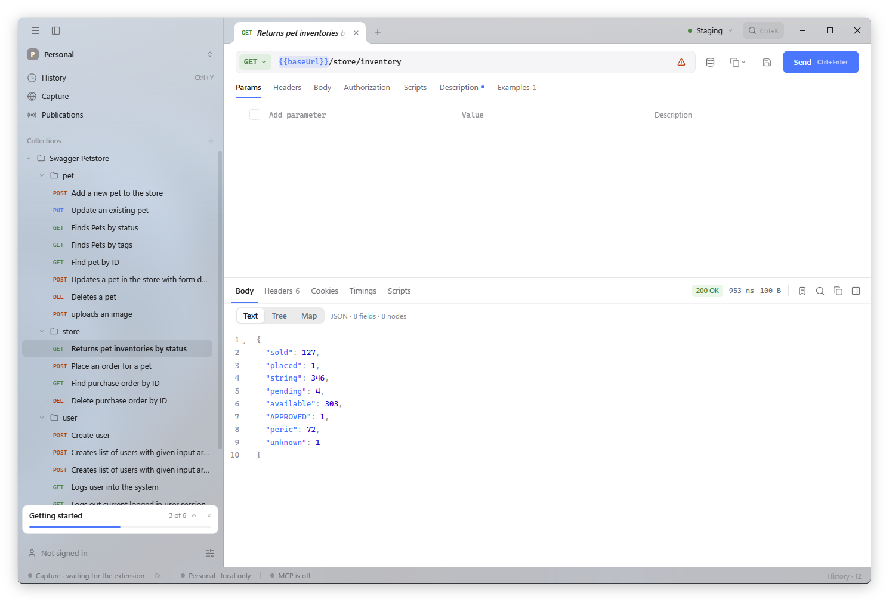

# Schemo

A fast, native API client for building, testing and sharing HTTP requests.

<picture>
  <source media="(prefers-color-scheme: dark)" srcset="docs/media/schemo-dark.png">
  
</picture>

## Features

- **Collections** with folders, inherited authorization and variables, and collection runs
- **Environments** with secret variables that never leave the device in exports
- **Authorization**: Bearer, Basic, API key, JWT, AWS SigV4, Digest, OAuth 2.0
- **Scripts** before and after a request, in a sandbox, with assertions
- **History** that is searchable and keeps every response
- **JSON:API** navigation, JSON tree, map and type views
- **Import** Postman, Insomnia, OpenAPI, HAR and cURL; **copy** as cURL, fetch, wget, HTTPie or PowerShell
- **Team workspaces** with sync, roles and published documentation
- **Browser capture** through the [extension](https://github.com/schemo-app/extension)
- **MCP server** so agents can read and send your saved requests ([docs](docs/MCP.md))

## Install

Download the latest build from [Releases](https://github.com/schemo-app/schemo/releases).

| Platform | Package | Requires |
|---|---|---|
| macOS | `.dmg` | macOS 12+ |
| Windows | installer | Windows 10+ |
| Linux | `.deb` | GTK3, WebKit2GTK 4.1 |

Updates are signed and verified before they install.

## Data

Everything is stored locally in `~/.schemo`. The SQLite database is not encrypted; refresh tokens
live in the OS credential store. Cloud content is encrypted at rest, not end to end.
See [Data, sync and protection](docs/DATA.md).

## Development

Requires Go ([go.mod](go.mod)), Node.js ([.node-version](.node-version)), [Task](https://taskfile.dev/)
and the Wails platform dependencies.

```sh
task dev                 # run with hot reload
task test                # checks and tests
task build               # build the app
task package             # native package
task generate:bindings   # after changing a bound Go method
```

Start with [Architecture](docs/ARCHITECTURE.md).

## Documentation

- [Architecture](docs/ARCHITECTURE.md)
- [Data, sync and protection](docs/DATA.md)
- [MCP](docs/MCP.md)
- [Translations](docs/TRANSLATIONS.md)
- [Releases](docs/RELEASE.md)

## License

[MIT](LICENSE.md)
